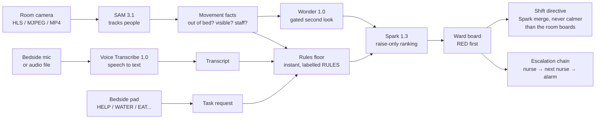
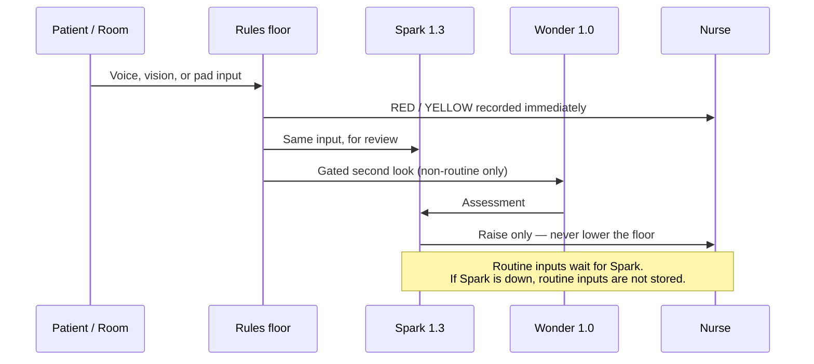
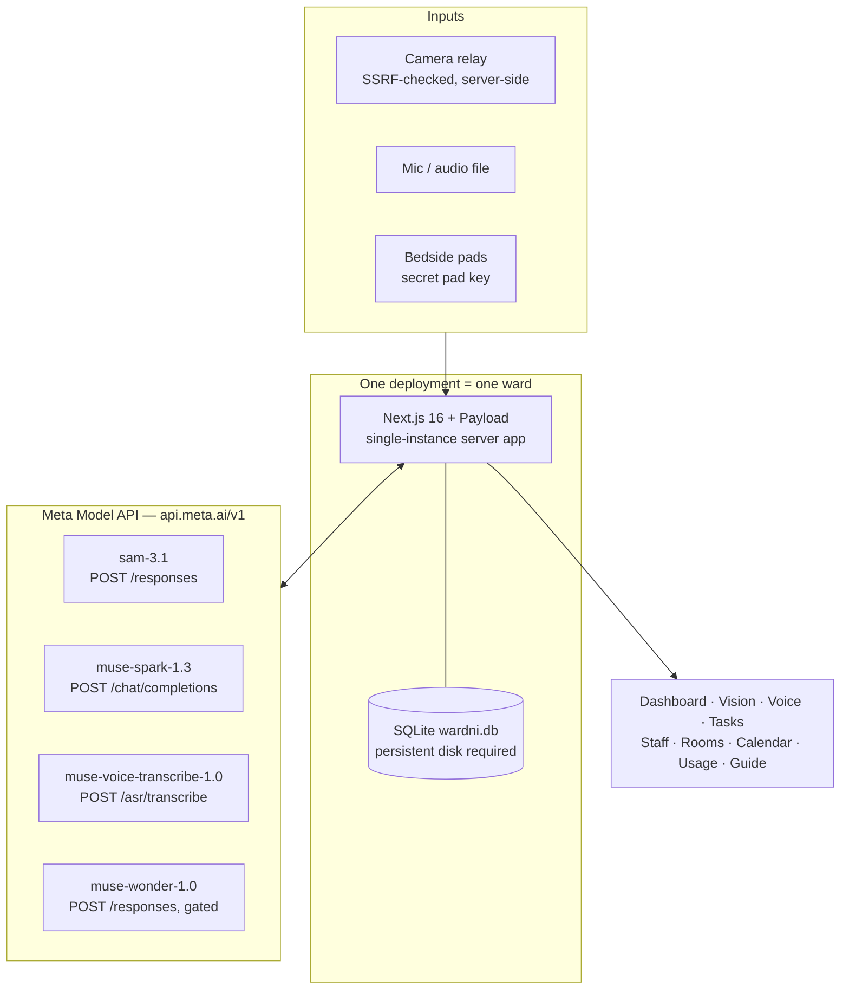

<h1 align="center"> Ulebi × Meta AI</h1>

<p align="center">
  <strong>An AI agent that runs the hospital night shift.</strong><br />
  Watching every room in low light, listening to patients, and telling the nurse what is urgent first.
</p>

<p align="center">
  
  
  
  
  
  
</p>

<p align="center">
  <strong>Night-shift Ward Command Center — one nurse, one dashboard, a whole ward at night.</strong><br />
  Vision alerts, voice requests, triage order, and shift directive in one dashboard.
</p>

> **Honest status, in one place.** Ulebi is a hackathon prototype built 26 Oct – 4 Nov 2026.
> It runs on simulated, fictional patients only, with a nurse in the loop.
> It is **not a clinical device, not medical advice, and not a diagnosis or treatment tool**.
> Live Meta verification with a real key is pending — see [Status](#status-what-is-proven-and-what-is-not).

---

## Contents

- [What it is](#what-it-is)
- [Before you start](#before-you-start)
- [How it works](#how-it-works)
- [Setup guide](#setup-guide)
- [Architecture](#architecture)
- [Meta models](#meta-models)
- [Screens](#screens)
- [Run it yourself](#run-it-yourself)
- [Status: what is proven and what is not](#status-what-is-proven-and-what-is-not)
- [Safety and privacy](#safety-and-privacy)
- [Docs](#docs)
- [License](#license)

---

## What it is

The idea comes from night wards where patients suffer when nobody is watching —
mistreatment and neglect at night cost lives, because a patient who cannot call out, get up,
or reach a button is left alone until the next round. And the night shift itself harms the
nurses: full nights of fatigue, stress, and broken sleep wear them down.

Ulebi closes that gap. It watches the whole ward through the night, so no room is ever
unwatched, and it carries the coordination work so one nurse on duty can run a ward that
would otherwise need a full night team. That is the aim: ten people's coordination work,
carried by one nurse plus the agent.

Ulebi — “at your service” — watches, listens, triages, and hands off. It never decides care. It orders the work
by urgency so the nurse can act on the right room first.

Scope is deliberately narrow — **watch, listen, triage, handoff only**.
Medication, MAR, vitals numbers, dispensing, and EHR work are out of scope.

## Before you start

Three things, in this order — skip none of them:

1. **Meta credits and one API key.** The models run on Meta's servers and are
   paid for with Meta Model API credits. Buy credits first, create one key
   (it connects all four models), and paste it in the app's AI settings.
   Without credits there is no AI — the ward runs on its safety rules only.
2. **An IR / low-light camera in every room.** Night vision needs infrared or
   a low-light sensor. The app reads HLS, MJPEG, or MP4 streams — not raw
   RTSP, so a camera that only speaks RTSP needs a converter to HLS first.
3. **A microphone in every room.** A bedside mic, or a camera with a built-in
   mic used as that room's mic input — that is how voice transcription works.
   The vision video check itself is video-only; it does not transcribe a
   camera's audio track.

Full guide, first setup to last step: [docs/SETUP-GUIDE.md](docs/SETUP-GUIDE.md).

## How it works





1. **Watch.** Low-light camera feeds go through SAM 3.1 tracking. The nurse sees a wireframe,
   not raw video, in Privacy Mode.
2. **Listen.** Bedside mic or an audio file goes through Muse Voice Transcribe — in English, French, or Arabic — then Spark.
3. **Press.** A bedside pad press (HELP, WATER, EAT, DRINK, BATHROOM / WC, PAIN / COMFORT, and common tasks —
   more buttons can be added and linked the same way) reaches the board
   and names the nurse notified — or says plainly that no nurse is on duty.
4. **Triage.** Spark can only raise a verdict or enrich it. It can never lower the rules floor.
5. **Escalate / nurse call.** No acknowledge in the configured window → next on-duty nurse →
   automated alarm on RED. The chain assigns the on-duty nurse for the room and ward.
6. **Hand off.** The shift directive merges every room into one ordered plan, RED first.

## Architecture



Single-instance, not multi-tenant SaaS: one deployment is one ward, with its own admin key,
rooms, cameras, and nurses. Anyone can clone it, set their own key, and run their own instance.
Keys live in server process memory only — never in the browser, logs, database, or repo.
The database is SQLite only — there is no Postgres adapter in this code, so the host must
keep the database file on a persistent disk. Serverless hosts that wipe their disk do not work.

## Meta models

| Model | Role | Endpoint | Live status |
|---|---|---|---|
| SAM 3.1 | Video tracking, wireframe facts | `POST /v1/responses` (streamed, `mask_encoding: one_bit`) | Wired. Handshake route verified; live call with a real key pending. |
| Muse Spark 1.3 | Triage ranking, merge, assistant | `POST /v1/chat/completions` (strict JSON) | Wired. Handshake route verified; live call with a real key pending. |
| Muse Voice Transcribe 1.0 | Speech to text (16 kHz WAV, VAD segments) | `POST /v1/asr/transcribe` | Wired. No live handshake; live transcription pending. |
| Muse Wonder 1.0 | Gated second look on a clip | `POST /v1/responses` (file_id or snapshot) | Wired, gated (≥15 s/room, 3-failure breaker). Never handshaken; live assessment pending. |

A fake key correctly returns `SAM HTTP 401` and `Spark HTTP 401` separately — the endpoints
and model strings reach Meta's auth stage. That is not a live proof: only a real key turning
the checker to LIVE proves the models work end to end.

**SAM's three prompts.** Text: a short phrase per class ("patient in bed").
Visual (spatial): a box and/or points drawn on the video — precise, and what powers
the bed-zone filter and the patient lock. Exemplar: draw one example once, Spark turns
it into a short visual phrase that becomes the SAM prompt. Detail and pros/cons:
[docs/SAM-PROMPTS.md](docs/SAM-PROMPTS.md).

**How the four models work at once:** vision runs on 3.5-second slices, SAM tracks all
classes in parallel and returns movement facts; voice is transcribed, then ranked; a pad
press goes straight to ranking; Wonder runs only as a gated second look (non-routine,
at most once per room per 15 seconds, raise only); Spark ranks each section's input alone
and merges all rooms into one RED-first directive. Short slices, gated second looks, and
small strict-JSON rankings keep it fast and affordable — continuous SAM on all rooms is
never run. Full workflow with diagrams: [docs/MODELS.md](docs/MODELS.md) and
[docs/PROJECT-RECAP.md](docs/PROJECT-RECAP.md).

**How to check any claim in this README:** the app source is in `app/`. SAM prompts and
tracking: `app/src/lib/wardni/vision.ts`. Ranking and rules floor:
`app/src/lib/wardni/triage.ts` and `app/src/app/(frontend)/ward-api/triage/route.ts`.
Voice: `app/src/app/(frontend)/ward-api/voice/transcribe/route.ts`. Second look:
`app/src/lib/wardni/wonder.ts`. Checker: the AI settings modal in
`app/src/components/wardni/AppShell.tsx`.

Cost discipline is built in: no continuous rolling SAM on all rooms. Monitoring samples
and gates (short slices, motion-gated windows, full analysis only on suspected events).

## Screens

Dashboard · Vision (per room, classes + bed zone + wireframe) · Voice (mic + file, Muse only) ·
Tasks / bedside pads · Staff and on-duty roster · Rooms and cameras · Calendar · Usage and costs ·
Guide · AI assistant · AI settings (keys, live status, API log).

The public homepage in this repo is `index.html` — a finished product page, separate from
the dashboard app. The dashboard is not embedded in the homepage.

## Demo

A 3-minute demo video is recorded against the current `v12v6-simple` screens, with
simulated patients and the RULES fallback shown plainly where AI is unavailable.
The video link is added at portal submission time — no link is claimed here
before it exists.

## Setup guide

**Start here:** [docs/SETUP-GUIDE.md](docs/SETUP-GUIDE.md) — Meta account,
credits, and key; server install; first admin; rooms, staff, cameras, bed
zones, and SAM prompts; the live AI check; daily night use; weekly costs,
privacy, and troubleshooting.

## Run it yourself

Short version (full steps in the setup guide and [docs/SELF-HOST.md](docs/SELF-HOST.md)):

```bash
cd app
pnpm install
pnpm payload migrate   # first run only
pnpm dev               # first admin at /admin
```

Then open AI settings, paste your Meta key, and click **Save and connect**.
Pass is per-model **Connected**. A failure shows the exact per-model error in
plain words — never a fake LIVE state.

> This is the full edition: `app/` contains the complete runnable source
> (`ulebi-v12v6-simple`, 49 tests passing, build compiling) — Next.js 16 + Payload,
> SQLite, all screens, the simplified Vision / login / checker, the Meta checker,
> and the no-fake-data rules.

## Status: what is proven and what is not

| Area | Proven |
|---|---|
| Build | 49 tests pass, `pnpm build` compiles, all routes present |
| Demo smoke (no real key) | v12v6-simple: login, vision/dashboard, untranscribed 400. v12v5-fixed (same logic, earlier UI): room creation, voice routine/RED rules events, pad WATER/EMERGENCY, escalation, merge directive |
| Checker | Independent SAM/Spark errors (not collapsed), `voiceReady` only when LIVE, Wonder shown as "Ready (gated)" not LIVE |
| Rules floor | RED / YELLOW events are recorded immediately and labelled RULES; AI can only raise, never lower |
| Not proven | Any live call with a real key, SAM wire parsing against a real payload, Wonder live assessment, live mic transcription, camera relay with a real stream, patient marker-colour identification, Usage dollar costs (hardcoded estimates), RTSP, two-way intercom |

Full table: [docs/STATUS.md](docs/STATUS.md).

## Safety and privacy

- Simulated, fictional patients only. No real hospital, no real patient data, no real ward footage.
- No face recognition. Patient identification is by bed zone plus a bright marker colour
  (proposal, untested) — never by face.
- Privacy Mode hides raw video and shows the wireframe only.
- API keys are server-memory only and are never returned to the browser.
- Nurse in the loop at every step. The system alerts and orders; care decisions stay with the nurse.
- This is a prototype, not a clinical device and not a replacement for nurses.

## Docs

- [docs/SETUP-GUIDE.md](docs/SETUP-GUIDE.md) — full guide: Meta credits and key, server, rooms, cameras, bed zones, AI check, daily use
- [docs/charts/](docs/charts/) — pro diagrams from the latest build: 4-model architecture, SAM prompting modes, and the 10-to-1 clinical impact chart
- [docs/MODELS.md](docs/MODELS.md) — each model's features, SAM's three prompts, the four-model workflow, and the cost controls
- [docs/PROJECT-RECAP.md](docs/PROJECT-RECAP.md) — idea, features, bedside buttons, nurse call, and the four-model workflow with diagrams
- [docs/ARCHITECTURE.md](docs/ARCHITECTURE.md) — sections, pipeline, escalation, data model
- [docs/SAM-PROMPTS.md](docs/SAM-PROMPTS.md) — SAM text, visual (spatial), and exemplar prompts, with examples
- [docs/HOW-IT-WORKS.md](docs/HOW-IT-WORKS.md) — every screen, every model connection, end-to-end examples
- [docs/SELF-HOST.md](docs/SELF-HOST.md) — install, migrate, run, key check
- [docs/STATUS.md](docs/STATUS.md) — proven vs unproven, checker behaviour, known limits
- [docs/CHANGELOG.md](docs/CHANGELOG.md) — build log (day-by-day log to be added later from verified records)

## License

MIT.
