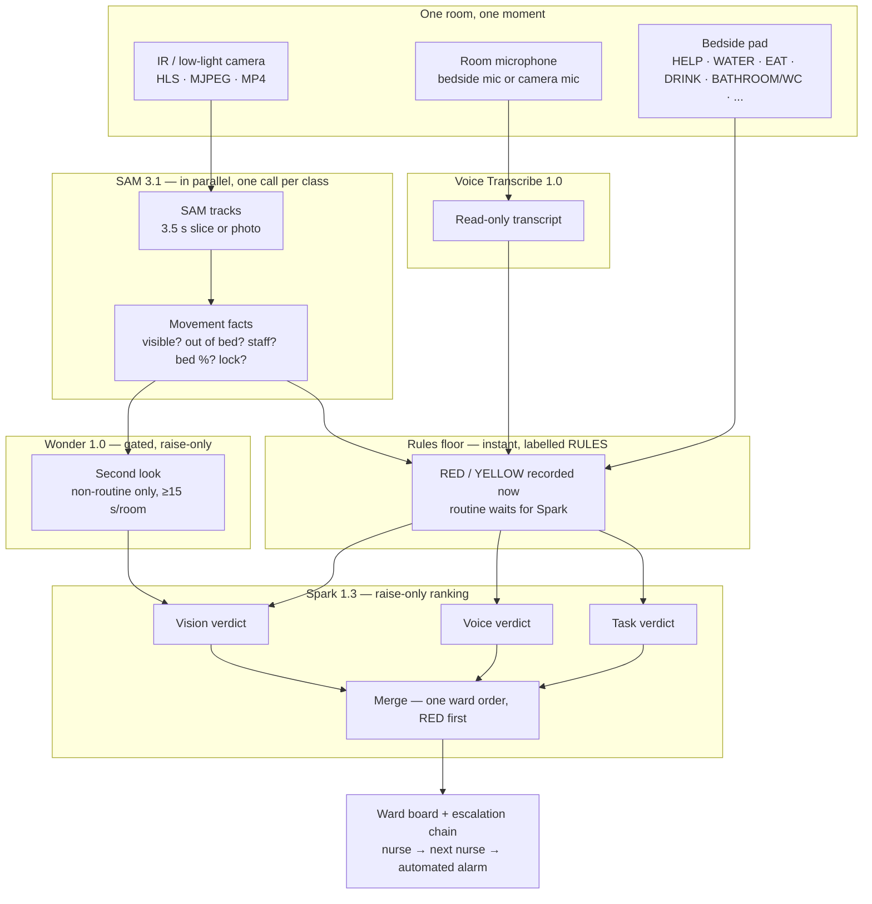
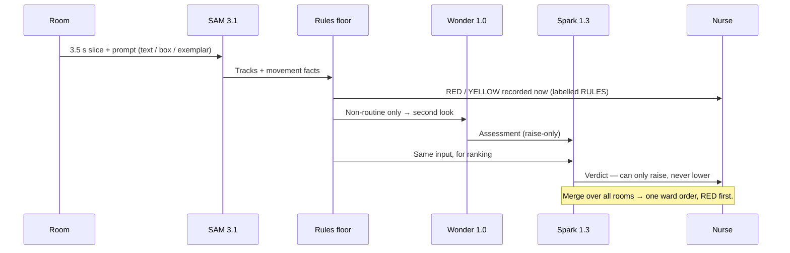

# Meta models — what each one does, and how they work together

Ulebi runs on four Meta models, all through the **Meta Model API**. Nothing runs on
your PC except the app itself: the models run on Meta's servers, and the app only
sends them the slice, clip, or text they need, then records their answer.

One API key connects all four. The key lives on the server only — it is never
shown in the dashboard, never in the repo, and never in a chat message.

> **Cost first.** Every call costs credits. Before anything else, buy credits on the
> Meta Model API (see [SETUP-GUIDE.md](SETUP-GUIDE.md), Step 1) and keep the app's
> gating on: short slices, motion-gated checks, and a gated second look are what
> keep a whole night affordable. Continuous, ungated video on every room is not
> how this app is run.

---

## 1. SAM 3.1 — Watching (vision tracking)

**Job:** find and follow people and things in a room, frame by frame, and return
their positions as outlines (masks) the app can reason about.

**What it does, in plain words:**

- **Detects, segments, and tracks in one call.** Give it a video slice or a photo
  and a prompt, and it returns tracked outlines with an identity that is kept
  across frames — no separate tracker, no training, no fine-tuning.
- **Zero-shot.** It has never seen your ward. It follows what the prompt describes.
- **Up to 16 objects per frame.** Above that, tracking degrades — one room at a
  time, one bed at a time, is the working unit.
- **Low light / IR.** SAM works on the picture the camera gives it. At night that
  means an IR or low-light camera in every room (see the setup guide). Colour
  markers are invisible to a pure IR picture — use an IR-bright marker if you
  rely on markers at night.

### SAM's three prompt types

The nurse never writes a prompt from scratch. The Vision section offers three
ways to tell SAM what to watch, and they can be combined per room:

| # | Prompt type | How it works | Best for | Limit |
|---|-------------|--------------|----------|-------|
| 1 | **Text prompt** | A short phrase, e.g. `patient in bed (person lying in hospital bed wearing patient gown)`. The description in brackets is appended to the same text string. Up to 8 classes per room: label, description, role (Patient / Staff / Equipment), colour. Defaults: patient in bed, medical staff. | Fast setup, no drawing, easy to edit | Ambiguous — "person" matches staff, visitors, and other patients too. It cannot tell two patients apart by itself. |
| 2 | **Visual (spatial) prompt** | A box and/or points drawn on the video overlay, in pixel coordinates at the source resolution, e.g. a box around the bed plus a point on the patient. Falls back to the text prompt if nothing is drawn. | Precise. This is what powers the bed-zone filter and the patient lock: a track must overlap the bed zone to count as the patient. | Breaks if the camera or the bed moves — redraw the box. The exact wire format is the app's construction and has not yet been proven against a live SAM payload. |
| 3 | **Exemplar prompt** | The nurse draws a box around one example — a patient in a blue gown, an IV pole — once. Spark turns that crop into a 2–5 word visual phrase (e.g. `patient in blue hospital gown`), and that phrase becomes the SAM text prompt. The crop itself is never sent to SAM. | Specific objects and specific patients, without training | Needs Spark live first; if Spark is down, the app silently falls back to the original label. A bad crop gives a generic phrase. |

**Patient vs staff, without face recognition.** The app resolves a track in this
order: continuity lock first (same track as before), then a track starting
mostly inside the bed zone, then a single-person track, then — if none of those
fits — `UNRESOLVED_PERSON`, which is shown as "not sure yet" and never silently
counted as staff. Staff is only ever assigned from a Staff-role class or an
exclusion keyword. There is no face recognition anywhere in Ulebi.

**Patient photo lock (Spark, not SAM).** An admission reference photo plus the
first frame go to Spark, which returns a box and a visual description. That box
becomes the class's spatial box and the description becomes its description.
The photo stays in the browser; only the first frame is used.

**How to check it in the source:** `app/src/lib/wardni/vision.ts`
(prompt building, wire parsing, `computeFacts`), `app/src/lib/wardni/meta.ts`
(SAM model id and request shape).

---

## 2. Muse Spark 1.3 — Deciding (triage ranking)

**Job:** rank how urgent something is. Spark decides the **order** of work. It
never decides care, never diagnoses, never treats, never prescribes, and the
nurse can always override it.

**What it does, in plain words:**

- Takes one input at a time and returns a strict verdict: level (RED / YELLOW /
  routine), a one-line headline, a reason, and the next nurse action.
- **Vision verdict:** from SAM's movement facts alone (patient visible? out of
  bed? staff at bedside? bed overlap? patient locked?).
- **Voice verdict:** from a transcript alone.
- **Task verdict:** from a pad press alone (HELP, WATER, EAT, DRINK, BATHROOM /
  WC, and other common tasks).
- **Merge verdict:** from the room snapshots together, producing one shift
  directive for the whole ward, RED first. The merge can never read calmer than
  the room boards — it is a ranking, not a second opinion.

**The rules floor comes first.** Before any AI call, a deterministic rules
floor runs on the same input. A RED or YELLOW floor event is recorded
immediately and labelled RULES. Spark may only **raise** a verdict or enrich it;
it can never lower the floor. A routine input with Spark down is not stored at
all — it waits for the AI, rather than being faked.

**How to check it in the source:** `app/src/lib/wardni/triage.ts`,
`app/src/app/(frontend)/ward-api/triage/route.ts`,
`app/src/lib/wardni/rules.ts`.

---

## 3. Muse Voice Transcribe 1.0 — Listening (speech to text)

**Job:** turn speech into text. Nothing else. It does not understand, rank, or
answer back — that is Spark's job, and Spark only sees the transcript.

**What it does, in plain words:**

- Takes a microphone recording or an audio file, split into voice segments at
  16 kHz, and returns a read-only transcript.
- The transcript is shown as-is. It cannot be edited in the app.
- Silence is rejected server-side, and speech heard but not transcribed is not
  stored — the nurse is told to check the patient in person instead.
- **Voice in every room:** each room needs a microphone — a bedside mic, or a
  camera with a built-in mic used as that room's mic input. The vision video
  check itself is video-only and does not transcribe a camera's audio track;
  voice comes through the voice section's mic or audio file.

**How to check it in the source:** `app/src/app/(frontend)/ward-api/voice/transcribe/route.ts`,
`app/src/app/(frontend)/voice/VoiceView.tsx`.

---

## 4. Muse Wonder 1.0 — Second look (gated assessment)

**Job:** look at a short clip a second time, only when something is already
unusual, and say whether the situation is worse than it first looked.

**What it does, in plain words:**

- **Gated, never always-on.** It runs only for non-routine events — out of bed,
  patient not visible, or an unresolved person — and at most once per room per
  15 seconds.
- **Raise-only.** Like Spark, it can only raise a verdict, never lower it.
- **Circuit-broken.** After 3 failures it stops trying, so a broken model does
  not burn credits or block the ward.
- **Not a model for routine work.** Routine events never pay for Wonder.

**How to check it in the source:** `app/src/lib/wardni/wonder.ts`
(`shouldAssess`, rate limit, breaker).

---

## How the four work at once — the real workflow

**Why it is efficient — the five cost controls, all in code:**

1. **Short slices.** Vision works on 3.5-second slices and single photos, never
   on a continuous stream. Uploaded files are deleted after the verdict, and
   leftovers are swept after 15 minutes.
2. **Parallel, not serial.** SAM classes are called in parallel, and the AI
   checker handshakes SAM and Spark in parallel — one slow model does not hold
   up the others.
3. **Gated second look.** Wonder only runs when something is already unusual,
   and at most once per room per 15 seconds.
4. **No duplicate routine work.** The same routine verdict within 5 minutes is
   not re-recorded.
5. **Routine waits, urgent does not.** RED and YELLOW are recorded by the rules
   floor instantly, even if an AI call is still running or has failed. Routine
   inputs wait for Spark — and if Spark is down, they are not stored, rather
   than being invented.

---

## Status: what is proven, what is not

Proven in code and in local smoke tests: the full chain above, the rules floor,
the gating, the raise-only rule, and the 49 automated tests. **Not yet proven:
any live call with a real Meta key.** The SAM wire format, the exemplar phrase
quality, and real latency and cost per call are all unmeasured until the first
real-key run. See [STATUS.md](STATUS.md) for the exact list, and run the
checker in the app's AI settings before claiming any model is live.
