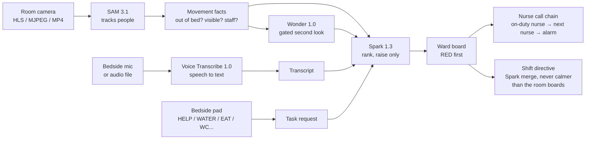
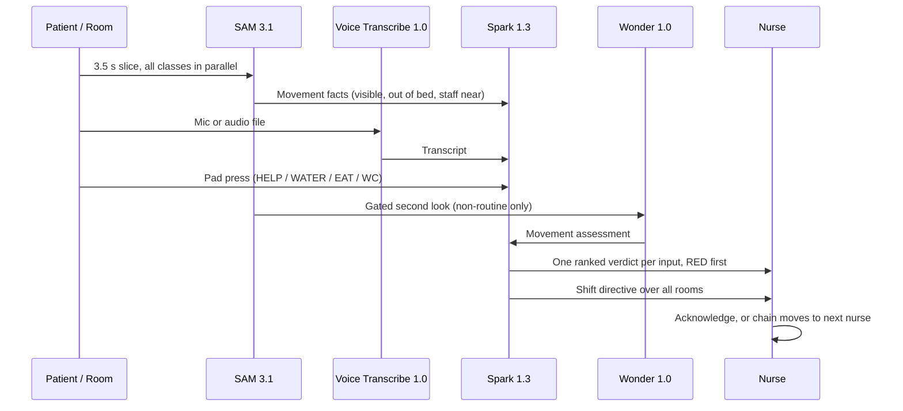

<p align="center">
  
</p>

<h1 align="center">Ulebi — Project Recap</h1>

<p align="center">
  <strong>An AI agent that runs the hospital night shift.</strong><br />
  Watching every room in low light, listening to patients, and telling the nurse what is urgent first.
</p>

<p align="center">
  
  
  
  
</p>

## The idea — where it comes from

At night, wards go quiet and one nurse covers many rooms. Patients suffer when
nobody is watching: mistreatment and neglect at night cost lives, because a
patient who cannot call out, cannot get up, or cannot reach a button is left
alone until the next round. At the same time, the night shift itself harms the
nurses — full nights of fatigue, stress, and broken sleep wear them down and
put their health at risk.

Ulebi exists to close that gap. It is an AI agent that watches the whole ward
through the night, so no room is ever unwatched, and it carries the
coordination work so one nurse on duty can run a ward that would otherwise
need a full night team. That is the aim: ten people's coordination work,
carried by one nurse plus the agent — not a measured result, a design goal
the whole product is built around.

## The AI agent — what it is

One agent, one ward, one dashboard. It does four things, and only four:

1. **Watch** — every room, in low light, through the night.
2. **Listen** — every patient voice request, transcribed and ranked.
3. **Triage** — everything ordered by urgency, RED first, never by room number.
4. **Hand off** — one ordered shift directive for the nurse, and a morning
   summary of the night.

It never decides care. It never diagnoses, treats, or prescribes. The nurse
still decides, and can override the agent. Scope is deliberately narrow:
watch, listen, triage, handoff only. Medication, MAR, vitals numbers,
dispensing, and EHR work are out of scope.

## Features

### Ward dashboard — one order for the whole ward

- Every room, every event, sorted RED first, then YELLOW, then routine.
- A shift directive that merges all rooms into one ordered plan.
- Staff and on-duty roster, rooms and cameras, calendar, usage and costs,
  in-app guide, AI assistant, and an API log.
- Privacy Mode: the nurse sees a wireframe, not raw video.

### Vision — SAM 3.1 watches the rooms

- Per room: up to 8 classes (label, description, role, colour), a bed zone
  drawn on the overlay, and a wireframe overlay on the live view.
- Sources: room camera (HLS / MJPEG / MP4 relay), webcam, or an MP4 / MOV
  clip up to 40 MB. No RTSP.
- Patient vs staff: continuity lock first, then a track starting inside the
  bed zone, then a single-person track — otherwise UNRESOLVED_PERSON, never
  silently relabelled as staff. Staff comes from Staff-role classes or the
  negative exclusions (medical staff, nurse, doctor, visitor).

### Voice — patients speak, the agent listens

- Bedside mic or audio / video file, transcribed by Muse Voice Transcribe.
- The transcript is read-only and goes to Spark for ranking.
- Voice is patient to nurse only. Two-way intercom is not built.

### Bedside buttons — eat, WC, and everything a patient needs

- A bedside pad in every room, with buttons for HELP, WATER, EAT, DRINK,
  BATHROOM / WC, and common tasks — more buttons can be added and linked
  the same way.
- Every press is linked straight into the dashboard: it appears on the ward
  board, goes to Spark for ranking, and names the nurse notified — or says
  plainly that no nurse is on duty. A routine press creates no alarm.
- A patient request is always stored, even when the AI is down.

### Nurse call — the agent calls the nurse who can help

- When an event needs a nurse, the escalation chain assigns the on-duty
  nurse for that room and ward.
- No acknowledgement in the configured window, and the chain moves to the
  next on-duty nurse.
- Still nothing, and the event is RED, and the automated ward alarm fires.
- Alerting only — the nurse who arrives decides the care. (Note: this is a
  dashboard nurse-call and escalation chain, not a telephone call and not a
  location-based proximity call — neither is built.)

## How the four Meta models work together — the real workflow

This is the whole product in one pipeline. Nothing here is a separate demo:
every input flows through the same chain, at the same time, and lands on the
same board.





### Step by step, in order

1. **Capture, in short slices.** Vision works on 3.5-second slices, not a
   continuous stream. A slice is uploaded, analysed, and its file is deleted
   after the verdict. Voice works on short segments, not an open mic.
2. **SAM tracks, all classes at once.** One SAM call runs per class, in
   parallel — patient, staff, equipment — and SAM tracks each object with
   its identity preserved across frames, zero-shot, no training, no custom
   tracker. The wire of per-frame boxes is parsed into tracks, then into
   movement facts: patient visible, patient out of bed, staff near the bed,
   bed overlap, and the patient lock.
3. **Voice becomes text, then a verdict.** Voice Transcribe does speech to
   text only — no understanding, no ranking. Its transcript goes to Spark,
   which ranks it like any other input.
4. **Pads go straight to ranking.** A pad press skips vision and voice
   entirely and goes to Spark as a task request, so a patient asking for
   water or the bathroom is never waiting on a camera.
5. **Wonder is a gated second look, not a second opinion on everything.**
   It runs only when the facts or the rules say something is worth a second
   look (non-routine, out of bed, not visible, unresolved person), at most
   once per room per 15 seconds, and it can only raise a verdict, never lower
   one. It is circuit-broken after 3 failures.
6. **Spark ranks, and only ranks.** Spark takes one section's input alone —
   vision facts, a transcript, or a pad press — and returns level, headline,
   reason, and nurse action as strict JSON. It never diagnoses or prescribes.
   The ward board takes the highest verdict across all inputs, so the board
   can never read calmer than the rooms underneath it.
7. **Merge, once, for the whole ward.** The shift directive is one more Spark
   call over snapshots of every room, ordered RED first. It is the same call
   behind Synthesize Shift and Morning Handoff.
8. **Call the nurse, then escalate.** The board's RED and YELLOW events feed
   the nurse-call chain: on-duty nurse, then next on-duty nurse, then the
   automated alarm on RED.

### Why it is efficient — how the models work at once

- **Parallel, not sequential.** SAM runs all classes in parallel; the
  checker verifies SAM and Spark in parallel; each section's Spark verdict
  is computed from its own input alone, so vision, voice, and pads never
  queue behind each other.
- **Gated, not continuous.** Short slices, motion-gated windows, and full
  analysis only on suspected events. Continuous SAM on all rooms is
  unaffordable and is never run.
- **Small inputs, fast verdicts.** A 3.5-second slice, a short transcript, a
  single pad press — each Spark call is one small, strict-JSON ranking, with
  short timeouts (SAM 90 s, Spark 20 s, Wonder 45 s), not a long reasoning
  session.
- **One key, four models, one server.** A single Meta Model API key covers
  SAM, Spark, Voice, and Wonder, and all four run on Meta's servers — the
  ward PC only runs the Next.js app and the dashboard.
- **Nothing is re-done.** A routine vision verdict identical to the last
  one within 5 minutes is not re-recorded; uploaded files are deleted after
  the verdict; the patient lock carries across slices so SAM does not have
  to re-identify the patient every time.

## The models, and what each one does

| Model | What it does | Connection | Live status |
|---|---|---|---|
| SAM 3.1 `sam-3.1` | Video tracking: detect, segment, track, identity preserved across frames | `POST /v1/responses`, streamed, `mask_encoding: one_bit` | Wired. Live call with a real key pending. |
| Muse Spark 1.3 `muse-spark-1.3` | Triage ranking, shift merge, ward assistant — strict JSON, raise only | `POST /v1/chat/completions` | Wired. Live call with a real key pending. |
| Muse Voice Transcribe 1.0 `muse-voice-transcribe-1.0` | Speech to text only, 16 kHz WAV, VAD segments | `POST /v1/asr/transcribe` | Wired. Live transcription pending. |
| Muse Wonder 1.0 `muse-wonder-1.0` | Gated movement / situation assessment from a clip, raise only | `POST /v1/responses`, file_id or snapshot | Wired, gated. Live assessment pending. |

A fake key correctly returns `SAM HTTP 401` and `Spark HTTP 401` separately —
the endpoints and model strings reach Meta's auth stage. That is not a live
proof: only a real key turning the checker to LIVE proves the models work end
to end.

## How to check any of this in the source

You do not have to take this document's word for it. Everything above is in
`app/` in this repo:

- Endpoints and model IDs: `app/src/lib/wardni/meta.ts`
- SAM prompts and wire parsing: `app/src/lib/wardni/vision.ts`
- Spark ranking prompts and the merge: `app/src/lib/wardni/triage.ts`
- Vision / voice / pad pipeline and the nurse-call chain:
  `app/src/app/(frontend)/ward-api/triage/route.ts` and
  `app/src/lib/wardni/engine.ts`
- Wonder gating: `app/src/lib/wardni/wonder.ts`

## Run it yourself

Full steps: [SELF-HOST.md](SELF-HOST.md).

```bash
cd app
pnpm install
pnpm payload migrate   # first run only
pnpm dev               # first admin at /admin
```

Then open AI settings, paste your Meta key, and click **Save & Verify Live**.
Pass is `AI LIVE`. A failure shows the exact per-model error — never a fake
LIVE state.

## Before the agent can work — credits, cameras, microphones

The models run on Meta's servers, so the first setup step is not code: it is
buying Meta Model API credits and creating one API key (one key for all four
models), then pasting it in the app's AI settings and pressing Save and
connect. Without credits there is no AI — the ward runs on its safety rules
only, and the checker says so plainly.

In every room, two pieces of hardware are required:

- **An IR / low-light camera.** Night vision needs infrared or a low-light
  sensor. The app reads HLS, MJPEG, or MP4 streams — not raw RTSP, so a camera
  that only speaks RTSP needs a converter to HLS first.
- **A microphone.** A bedside mic, or a camera with a built-in mic used as that
  room's mic input. That is how voice transcription works: the vision video
  check itself is video-only and does not transcribe a camera's audio track;
  voice goes through the voice section's mic or an audio file.

Full steps, first setup to last: [SETUP-GUIDE.md](SETUP-GUIDE.md).

## SAM's three prompts, in one place

SAM is told what to watch in three ways (full detail, examples, and pros/cons
in [SAM-PROMPTS.md](SAM-PROMPTS.md)):

1. **Text prompt** — a short phrase per class, e.g. "patient in bed". Fast,
   editable, but ambiguous: "person" matches staff and visitors too.
2. **Visual (spatial) prompt** — a box and/or points drawn on the video.
   Precise, and what powers the bed-zone filter and the patient lock. Breaks
   if the camera or bed moves.
3. **Exemplar prompt** — draw one example once; Spark turns it into a short
   visual phrase that becomes the SAM prompt. Best for specific objects and
   patients, needs Spark live first.

Patient identification is by bed zone plus a bright marker colour per
patient/bed (IR-bright at night) — never by face recognition.

## How to check this recap against the source

Every claim above can be checked in `app/`, which is the complete runnable
source in this repo: SAM prompts and tracking in
`app/src/lib/wardni/vision.ts`; ranking and the rules floor in
`app/src/lib/wardni/triage.ts` and
`app/src/app/(frontend)/ward-api/triage/route.ts`; voice in
`app/src/app/(frontend)/ward-api/voice/transcribe/route.ts`; the gated second
look in `app/src/lib/wardni/wonder.ts`; the checker in the AI settings modal
in `app/src/components/wardni/AppShell.tsx`.
