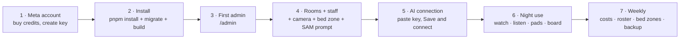

# Ulebi setup guide — from zero to a working night ward

This is the full guide: Meta account and credits first, then the server, then
the rooms, then the daily night-shift use. Follow it in order. Nothing here
requires a hospital IT department — one server, one ward, one admin key.

> **Honest scope, before you start.** Ulebi is a prototype for simulated,
> fictional patients, with a nurse in the loop. It is not a clinical device,
> not medical advice, and not a diagnosis or treatment tool. Live Meta
> verification with a real key is pending — run the AI checker (Step 5) before
> claiming any model is live.

---

## Step 0 — What you need in the room

One deployment is one ward. For every room you want watched, you need:

| In the room | Why | Notes |
|---|---|---|
| **IR / low-light camera** | Night vision. SAM watches the picture the camera gives it, and at night that picture has to come from infrared or a low-light sensor. | The app reads the camera as an **HLS, MJPEG, or MP4** stream URL. It does **not** read raw RTSP — if your camera only speaks RTSP, put a small converter in front of it that outputs HLS (for example a local media server or gateway) and give Ulebi the HLS URL. |
| **A microphone** | Voice. Patients speak, the app transcribes, Spark ranks the request. | A bedside mic, or a camera with a built-in mic used as that room's mic input. The vision video check itself is video-only — it does not transcribe a camera's audio track. Voice goes through the voice section's mic or an audio file. |
| **A bedside pad** | Buttons. HELP, WATER, EAT, DRINK, BATHROOM / WC, and any other common task — each press is a task request on the dashboard. | The pad is a screen in the app (a room link with its secret pad key), not a separate device you have to buy. More buttons can be added and linked the same way. |
| **A marker per patient (optional, recommended)** | Telling patients apart. SAM's text prompt alone cannot tell two patients apart. | One distinctive bright colour per patient/bed, plus the bed zone drawn on the video. At night on a pure IR picture, colour is invisible — use an **IR-bright marker** instead. No face recognition is used, ever. |

And for the server: a machine that stays on (a small VPS or any always-on
computer), Node 24 or newer, and a **persistent disk** — the ward database
(`wardni.db`) lives on that disk. Serverless hosts and hosts that wipe their
disk do not work: the database would be lost on every restart.

---

## Step 1 — Meta account, credits, and API key (do this first)

The models run on Meta's servers and are paid for with Meta Model API credits.
No credits, no AI — the app will run on its safety rules only, and the checker
will say so plainly.

1. Go to the Meta Model API developer site and create an account (an email and
   password, plus whatever verification the site asks for).
2. Open **Billing** and buy credits. The exact prices and packs are shown on
   the site; buy a small amount first and watch your usage after every test.
   The app's cost controls (short 3.5-second slices, gated second look, no
   duplicate routine records) are there to keep a night affordable — do not
   turn them off.
3. Open **API keys** and create one key. **One key connects all four models**
   (SAM, Spark, Voice Transcribe, Wonder) — there is no separate key per model.
4. Copy the key somewhere safe. You will paste it once, in the app's AI
   settings, in Step 5. **Never put the key in the repo, in a chat message, in
   a screenshot, or in a preview file.** The dashboard never shows it back to
   you — it only shows "connected" or "not connected" — and that is deliberate.

If you are on a hackathon credit grant, the same steps apply: claim the credits
on the billing page first, then create the key, then paste it in Step 5.

---

## Step 2 — Install the app

```bash
git clone <your-repo-url>
cd app
pnpm install
```

Then set the environment. The app needs two secrets in the shell (the Payload
CLI does not read `.env` files, so export them — sourcing a `.env` file works
too):

```bash
export PAYLOAD_SECRET="$(openssl rand -hex 32)"
export DATABASE_URL="file:$PWD/wardni.db"   # absolute path, on a persistent disk
export NEXT_PUBLIC_SITE_URL="https://app.your-domain.example"
export PORT=3000
```

First run only, create the database:

```bash
pnpm payload migrate
```

Then build and start:

```bash
pnpm build
pnpm start
```

For a server that survives reboots, run it under `pm2` or `systemd` — the
exact unit file is yours, the requirement is only that the process restarts
and keeps the same database file.

Point your domain at the server (a DNS A record) and put HTTPS in front of it
(Caddy or Nginx). The app is one Next.js server: dashboard pages, the
`/ward-api/*` routes, the Payload admin, and the database all live together.

---

## Step 3 — First admin account

1. Open the app and go to `/admin`.
2. Create the first admin account (the first login email in this build is
   `admin@ulebi.com` — change it to your own admin email on first login).
3. Sign in. You are now the admin for this ward: you manage rooms, staff,
   cameras, and AI settings. There are no other tenants and no other wards on
   this deployment.

---

## Step 4 — Rooms, staff, and cameras

Do these in order — a room needs its bed zone before vision means anything,
and a nurse needs to be on duty before a pad press can name anyone.

### 4a. Add a room

Dashboard → Add room. Give it a name (for example "Room 201") and, if you have
one, its camera stream URL (HLS, MJPEG, or MP4 — see Step 0 for the RTSP note).
No camera yet? You can still use a webcam or a test `.mp4`/`.mov` clip in the
Vision section — clips are for testing only, the product input is the live
room camera.

### 4b. Add staff and the duty roster

Staff page → add each nurse with their role (admin, charge nurse, nurse).
Put the on-duty nurses on the roster for the night. The escalation chain only
ever calls nurses who are on duty: first the on-duty nurse for the room, then
the next on-duty nurse, then the automated alarm on RED. If nobody is on duty,
a pad press says so plainly — "no nurse on duty" — instead of inventing a name.

### 4c. Draw the bed zone

Open the room in Vision → "Mark the bed area" and draw the bed on the video.
This is the single most important setup step: a track only counts as the
patient if it overlaps this zone, and it is how the app tells a patient from a
visitor or a nurse standing nearby. Redraw it if the camera or the bed moves.

### 4d. Tell SAM who to watch

Vision → Step 1, "Who to watch". Three ways, in order of effort:

1. **Describe in words** — the default classes ("patient in bed", "medical
   staff") are already there. Edit the wording if your ward looks different.
2. **Point on screen** — draw a box around the bed and a point on the patient.
   This is the precise option, and it powers the bed-zone filter and the
   patient lock.
3. **Show an example** — draw a box around one example (a patient in a blue
   gown, an IV pole) once; Spark turns it into a short visual phrase that
   becomes the SAM prompt. Needs Spark live; otherwise the app falls back to
   the written label.

Add the exclusions you never want counted as the patient — the defaults are
`medical staff, nurse, doctor, visitor`.

---

## Step 5 — Connect the AI (paste the key, verify live)

This is the step that proves the models work. Do it on the server, not in a
browser preview — a preview page that calls Meta straight from the browser
cannot verify anything (it is blocked by the browser and would expose the key).

1. Open the dashboard → **AI connection** (the "Meta API Keys" button).
2. Paste the one key from Step 1 into "Your Meta key (one key for all
   features)".
3. Press **Save and connect**. The app runs a live handshake against Meta for
   SAM and for Spark, in parallel, and reports each one separately.
4. Read the result in plain words:
   - **Connected** — that model answered. Vision, voice, or ranking using that
     model is live.
   - **Problem** — the plain sentence under the row says what happened
     ("The key was not accepted", "Meta took too long to answer", "Could not
     reach Meta"). The raw technical error is under "Technical details (for
     support)". A key problem shows as an authentication error, separately for
     SAM and for Spark — if Meta is unreachable, retry once; reachability from
     some networks is flaky.
   - **Not connected** — no key, or the check never ran. The ward runs on its
     safety rules only.
5. The sidebar shows the same in one line: "AI connected" or "Safety rules on
   (AI off)".

**If the key never passes, submit and run anyway on the rules floor — never
fake a LIVE status.** A RED or YELLOW rules event is still recorded instantly
and labelled RULES, and the nurse still sees the ward in RED-first order. What
you lose without the AI is ranking of routine work and the second look, not
the urgent alerts.

---

## Step 6 — A night with Ulebi (daily use)

### Watching a room

Vision → pick a room → **Check now** for one 3.5-second check, or **Watch
continuously** for a rolling loop (it pauses after repeated failures rather
than burning credits). Read the decision in Step 3: what the AI decided, why,
and what the nurse should do next. "How the decision was made" shows the three
steps in plain words: watching, second look (only when needed), decision.

Privacy Mode hides the raw video and shows outlines only — use it for any
recording or screen share.

### Listening to a patient

Voice → pick a room → speak into the mic, or load an audio file. The transcript
appears read-only, then Spark ranks it. If speech is heard but not transcribed,
nothing is stored and the screen says to check the patient in person. A routine
voice request with Spark down is not stored at all.

### The bedside pad

Each room has a pad link (protected by that room's secret pad key). The patient
presses HELP, WATER, EAT, DRINK, BATHROOM / WC, or another task. The press
appears on the dashboard, names the on-duty nurse notified — or says no nurse
is on duty — and a routine press does not start the ward alarm. Only RED and
YELLOW start the escalation chain.

### The ward board and the shift directive

The dashboard orders every room RED first, then YELLOW, then routine — never
room order. The shift directive (Dashboard → Synthesize Shift, and the Morning
Handoff button, which runs the same merge) combines every room into one
ordered plan. It can never read calmer than the room boards.

### Escalation / nurse call — what it is and is not

The "nurse call" is the escalation chain inside the app: it assigns the
on-duty nurse, then the next on-duty nurse if nobody acknowledges in the
configured window, then the automated alarm on RED. **It is not a telephone
call and not a location/proximity call** — neither is built. Alerting only:
care decisions stay with the nurse, who can always override the ranking.

---

## Step 7 — Costs, privacy, and what to check each week

- **Costs:** open Usage & Costs in the app and compare it with the Meta
  billing page after every night at first. The app's own cost figures are
  estimates from code, not a bill — Meta's billing page is the truth.
- **Privacy:** raw video is never stored as a recording by the app; vision
  slices are deleted after the verdict. Patient photos used for the photo lock
  stay in the browser. The key is in server memory only and is lost on restart
  — paste it again after a restart, or set it as an environment variable.
- **Weekly check:** bed zones still match the cameras (redraw after any camera
  move), the roster for the coming nights is filled, the AI checker still says
  Connected, and the database file is backed up (it is the ward's whole history).
- **Troubleshooting, in order:** (1) Is the camera URL reachable and in
  HLS/MJPEG/MP4? (2) Is the bed zone drawn? (3) Does the AI checker say
  Connected, per model? (4) Is a nurse on duty for this room? (5) Is the
  server's disk persistent and the database file present? Most "nothing
  happens" reports are one of those five.

---

## Quick reference — the whole setup on one page



**Further reading:** [MODELS.md](MODELS.md) for each model's features and the
full workflow, [SAM-PROMPTS.md](SAM-PROMPTS.md) for the three prompt types in
detail, [HOW-IT-WORKS.md](HOW-IT-WORKS.md) for every screen,
[SELF-HOST.md](SELF-HOST.md) for hosting options, [STATUS.md](STATUS.md) for
what is proven and what is not.
